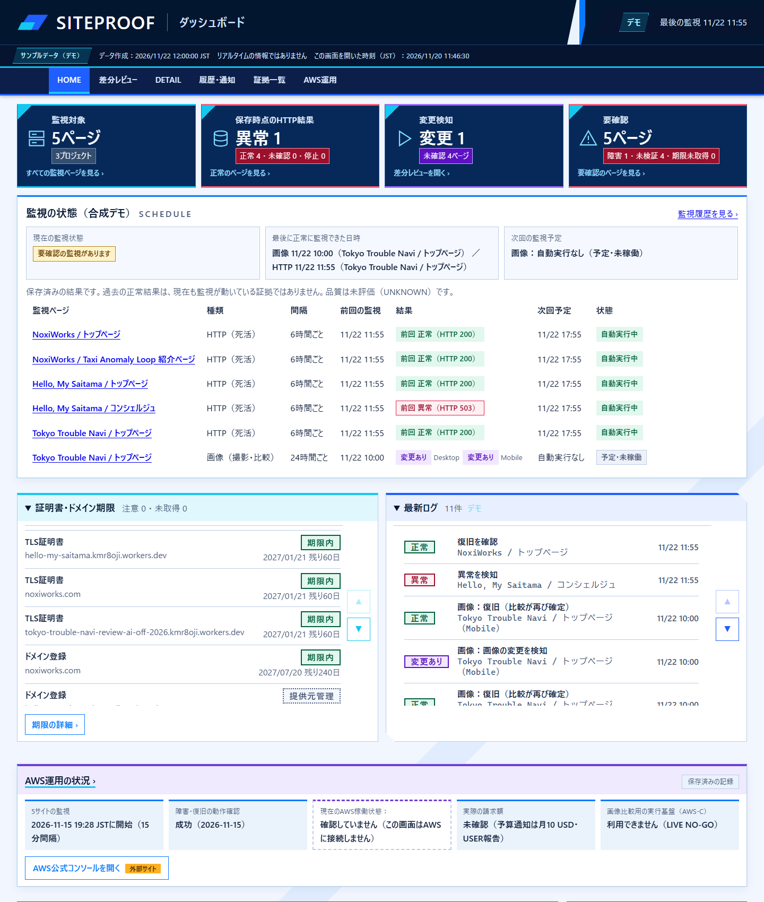
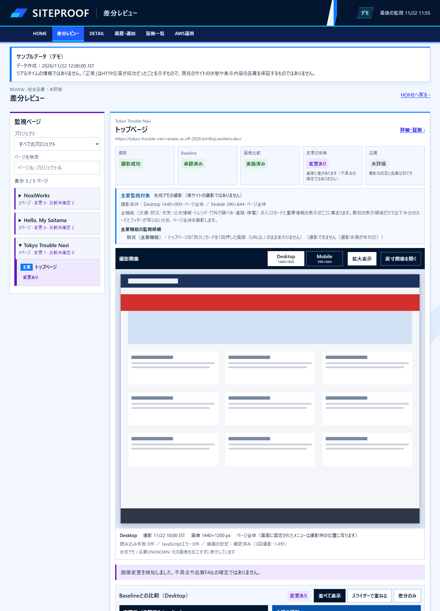
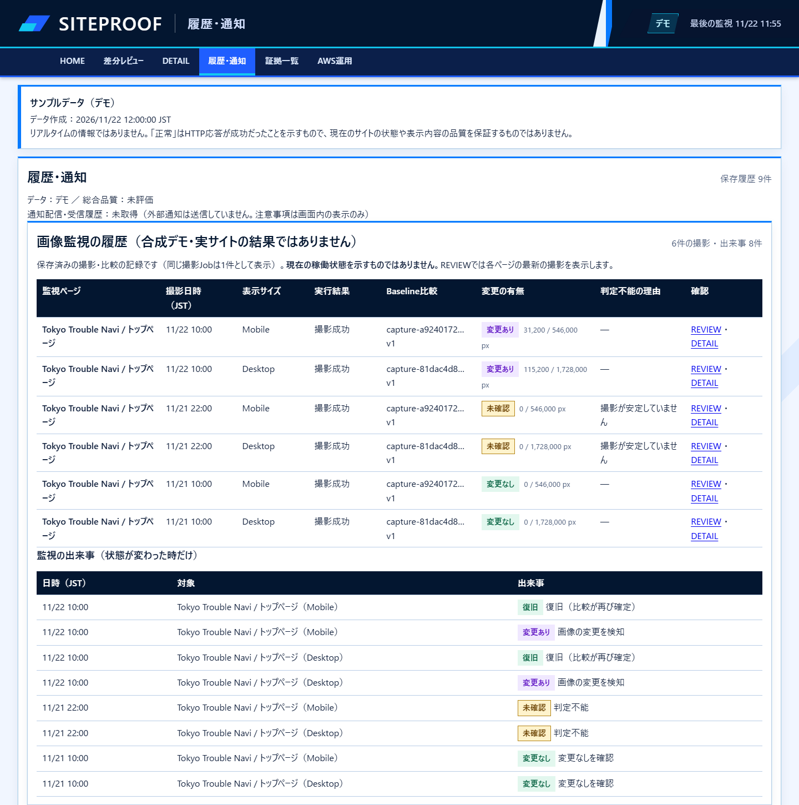
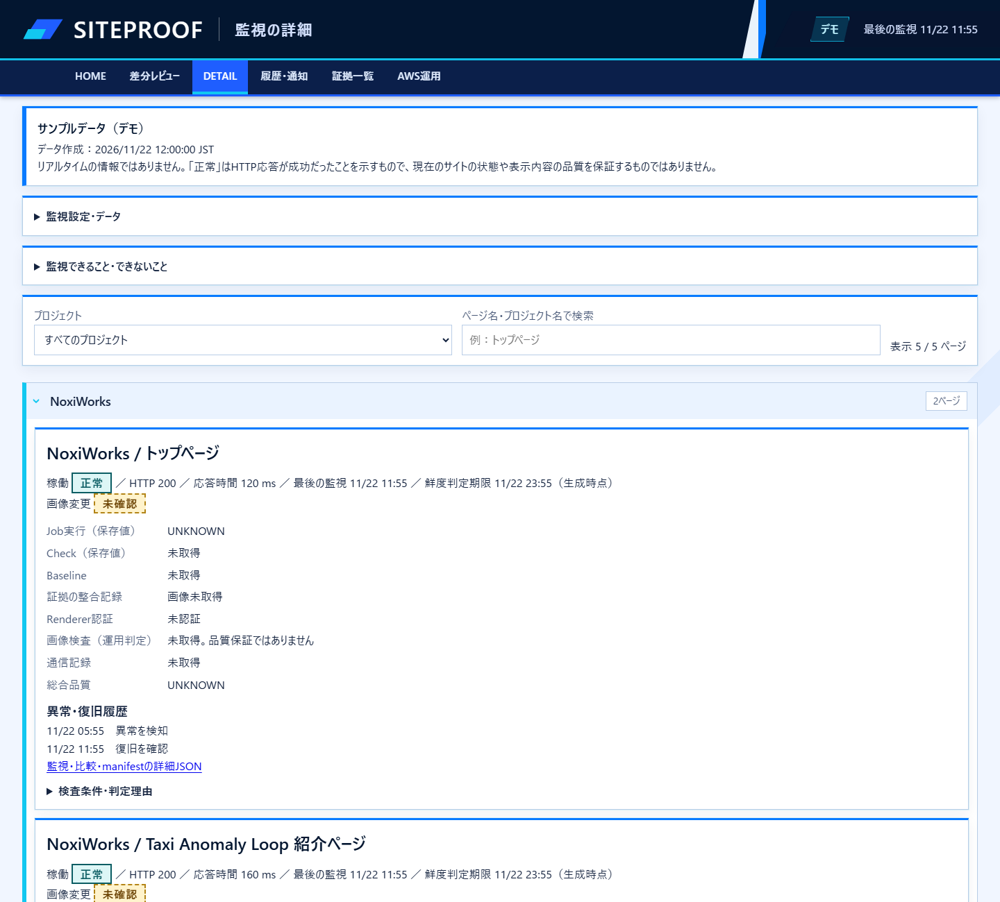
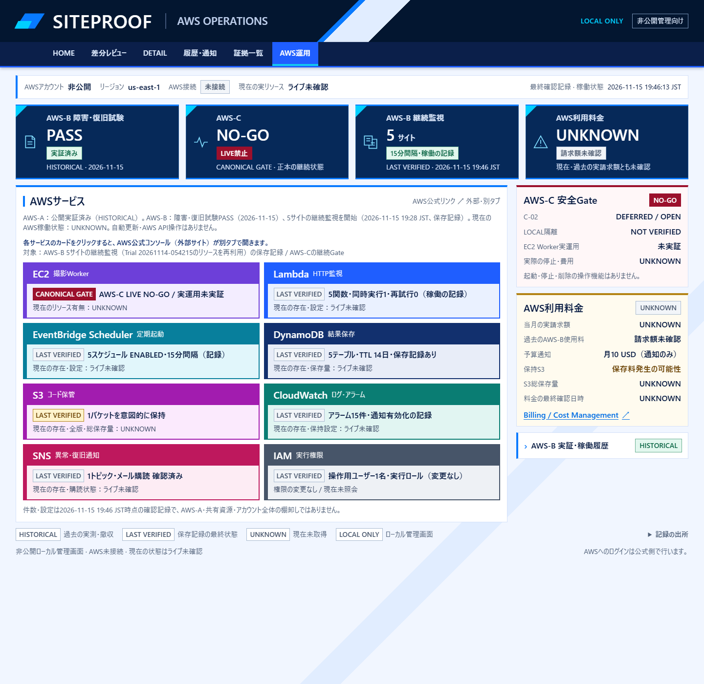
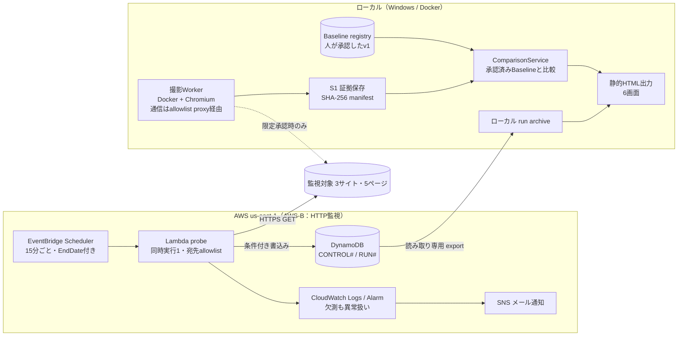

# SiteProof

SiteProofは、自分が管理するWebサイトのHTTP応答（死活）、画面の見た目の変化（Baselineとの画像比較）、検証証拠、監視履歴をまとめて確認する個人用の日本語Webアプリケーションです。

このリポジトリは、SiteProofを題材にした **AWSの設計・実装・運用のポートフォリオ** も兼ねています。実AWSや実サイトで確認した範囲（実測）、合成データで動きを示す範囲（合成デモ）、設計・実装だけの範囲（未実証）を分けて記載します。

> **MVP v1.0（2026-11-23）時点の状態**
> - **AWS-B Lite Trialは2026-11-23 19:00 JSTに監視を停止し、同日中にTrial専用の主要AWSリソースを撤収しました。** 現在、Trialの定期監視は稼働していません。当初の停止予定は2026-11-27 12:00 JSTでしたが、2026-11-23 19:00 JSTへ前倒ししました（AWS-B Liteは期限つきのTrialで、長期の安定稼働は実証していません）。残っているのは、共有候補のIAM権限境界ポリシー2件、保持期間中のCloudWatchカスタムメトリクス、ローカルの非公開の検証証拠とバックアップです。AWSの実請求額は未確認（UNKNOWN）です。
> - 低コスト版の **AWS-B Lite** は、1ページ＋一時fixtureで実測検証し（Stage A）、5ページすべてへ適用しました（Stage B、2026-11-23、AWSの記録を読み戻して確認）。6時間・12時間間隔は **未検証**、AWSの実請求額は **UNKNOWN** です。Heartbeat Alarmは移行前後に6回OK⇄ALARMを繰り返しました（誤報の可能性があり、落ち着くかは未確認）。
> - 画像比較は、実サイト（Tokyo Trouble Navi トップページ）で Desktop / Mobile の Baseline比較を1回実証しました。**定期的な画像監視は未完成**です。
> - 総合品質（strict quality）は常に **UNKNOWN** です。SiteProofは表示品質のPASSを判定しません。
> - AWS内の独立Stopperは **未適用** です（後述の「既知の制限」）。
> - `.local/` に保存した実環境の検証証拠（AWSの出力・ログ・保存データなど）は非公開で、この公開リポジトリには含まれません。



## 特徴

- **ページ別の状態変化通知**：HTTPの障害・復旧・判定不能の「変わった時」だけをメールで通知します（同じ状態を繰り返し送りません）。
- **低コストなAWS構成（AWS-B Lite）**：ページ別のAlarmとメトリクスを、集約Heartbeat 1本に置き換えました。5ページ・6時間間隔で月約0.41 USD（推定）です。
- **安全な停止制御**：絶対期限・世代・条件付き確保・同時実行0で、停止後や古いイベントは外部接続の前に拒否します。
- **ローカルの画像検査との統合**：HTTPの結果と、画面の見た目の変化（承認済みBaselineとの比較）を同じ画面で確認します。
- **日本語のダッシュボード**：6画面のローカルアプリ。AWSの資格情報は不要です。

CloudWatch Syntheticsの代替ではありません。機能の数では上回りません。費用の比較と、Syntheticsが有利な条件は [SYNTHETICS_COMPARISON.md](docs/aws_portfolio/SYNTHETICS_COMPARISON.md) にあります。

## SiteProofを起動する（ローカルアプリ）

> 初めての方は、Windowsでのインストールから、サイト登録・所有権の確認・監視許可・Baseline・監視の開始と停止・AWS保存結果の取り込み・データの場所・安全な終了までを順に説明した **[利用ガイド（docs/USER_GUIDE.md）](docs/USER_GUIDE.md)** を先に読んでください。

**必要なもの**：Python 3.15（標準ライブラリのみ）と、Webブラウザ（Firefox・Edge・Chromeなど）。AWS認証、Docker、インターネット接続は不要です。

> 動作確認はPython 3.15（Windows 11）とFirefox 160で行いました。Python 3.12より前では起動しません（3.10で構文エラーを確認）。3.12〜3.14は未検証です。

```powershell
git clone <このリポジトリ>
cd siteproof
py -3.15 -B -m src.noxiworks.app
```

macOS / Linux では `python3 -B -m src.noxiworks.app` を使います。

1. 起動すると既定のブラウザで `http://127.0.0.1:8765/` が開きます（開かない場合は、このURLをブラウザに入力します）。
2. HOMEの一番上の **「サイトを追加」** を押し、サイト名・ページのURL（https://）・画面サイズ（Desktop／Mobile）を入力します。「このサイトは自分が管理しています」を確認して **「登録して監視を始める」** を押します。
3. **登録すると監視が有効になりますが、実サイト撮影の条件が整うまで、撮影は行いません**（実サイトにアクセスせず、合成画像も作りません）。HOMEの「実サイト監視の準備」に、足りない条件（本人管理サイトの確認・署名付き監視許可・撮影構成の同一性・Docker）が表示されます。条件を整える手順は [docs/REAL_CAPTURE.md](docs/REAL_CAPTURE.md) です。条件が整うと、SiteProofが次を自動で行い、HOMEは結果に合わせて自動で更新されます。
   - 初回検査（Desktop・Mobileを撮影）
   - 安定して撮影できた初回の画像から、初期Baseline（比較の基準）を自動作成（「自動作成（未確認）」と表示）
   - 以後、選んだ間隔（15分・1時間・6時間・24時間。既定は1時間）で検査してBaselineと比較
   - 変更・判定不能・失敗をHOMEに表示し、**差分レビュー**と**履歴・通知**に保存
4. HOMEでは、監視状態・最終検査・次回検査予定・最終結果・Baselineの状態が一目で分かります。変更を検知した場合はHOMEの一番上に表示されます（外部への通知は送信しません）。
5. 終了はターミナルで `Ctrl+C` を押します。再起動すると、監視設定・Baseline・履歴がそのまま引き継がれ、予定どおり監視を続けます。アプリを閉じている間も監視したい場合は [docs/BACKGROUND_MONITORING.md](docs/BACKGROUND_MONITORING.md) を参照してください（OSのスケジューラーへの登録は自分で行います）。

**補助操作**（HOMEの「補助操作」を開いた中にあり、通常は不要です）：監視の停止・再開、検査間隔の変更、今すぐ再検査、自動作成のBaselineを「確認済み」にする。（動作確認用の撮影画像の設定欄もありますが、通常のアプリでは使われません。合成画像で検査できるのは、下の合成デモだけです。）

**Baselineのルール**：Baselineは、初回の「Desktop・Mobileとも撮影が完了し、安定していた」検査から自動で作ります。撮影が不安定・失敗のときは作らず、次の検査で再度試します。変更を検知しても、Baselineは自動では書き換えません。変更後の画面を新しい基準にするのは、差分レビューで利用者が **「新しい基準にする」** を押したときだけです（版は v+1 になり、古い版は残ります）。

- **実サイト撮影の条件が整うまで、撮影しません（重要）**：登録しただけでは、結果（撮影・Baseline・比較）は出ません。HOMEやREVIEWは「未撮影」「未取得」と表示します。撮影の条件（本人管理の確認・署名付き監視許可・撮影構成の同一性・Docker）は、HOMEの「実サイト監視の準備」に表示されます。条件を満たした場合だけ、署名付き許可の範囲内で、実サイトを撮影します（実サイトでの通しの確認は、作者の1サイトに限ります）。
- **合成デモ（`/demo/`）**：「同じ画面」「変更あり（画面上部に赤い帯）」「撮影が不安定」から画像を選んで検査できます。製品と同じ経路（撮影Job → RuntimeService → S1証拠保存 → ComparisonService → Baseline承認）を通し、結果はそれぞれ、変更なし・変更を検知（差分画像つき）・判定不能（撮影が安定していません）になります。画面には「サンプルデータ（デモ）」「合成デモ」と表示され、登録したサイトの結果とは混ざりません。
- 登録できるのは **1サイト・1ページ** です。URLは https の公開ホスト名に限ります（IPアドレス、localhost、ポート番号、ログイン情報、? や # は使えません）。
- 固定の合成デモ（Tokyo Trouble Navi を模した画面）は `http://127.0.0.1:8765/demo/` で、登録したサイトとは分けて表示します。
- データの保存先は `%LOCALAPPDATA%\SiteProof`（Windows）または `~/.local/share/siteproof` です。`--data <フォルダ>` で変更できます。ポートは `--port`、ブラウザを開かない場合は `--no-browser` を指定します。
- サーバーは `127.0.0.1` だけで待ち受けます。登録や補助操作には、同じ画面から取得した起動ごとの合言葉（トークン）が必要です。
- `--check-every <秒>` は動作確認用に検査間隔を短くするオプションです（通常は使いません）。

### 画面で操作できること・できないこと

| 操作 | 方法 |
|---|---|
| 起動・HOMEを開く | `python -m src.noxiworks.app`（ブラウザ） |
| サイトの登録（サイト名・URL・Desktop／Mobile） | **画面**（HOMEの「サイトを追加」） |
| 初回検査・初期Baseline作成・定期検査・比較 | **自動**（実サイト撮影の条件が整った後。整うまでは撮影しません） |
| 監視の停止・再開、間隔の変更、今すぐ再検査、Baselineの確認済み記録 | **画面**（補助操作） |
| アプリを閉じている間の監視 | OSのスケジューラーにコマンドを登録（利用者が実施。[docs/BACKGROUND_MONITORING.md](docs/BACKGROUND_MONITORING.md)） |
| 画像比較・変更箇所の確認 | **画面**（差分レビュー） |
| 監視履歴の閲覧・再起動後の状態保持 | **画面**（履歴・通知） |
| サイトの変更・削除、2サイト目の登録 | 未対応 |
| Baselineの正式承認・更新（変更後の画面を新しい基準にする） | **画面**（差分レビュー。利用者が押したときだけ。自動では行いません） |
| 実サイトの撮影 | **自動（署名付き監視許可の範囲内のみ・実サイトでは未実証）**。条件の状況はHOMEの「実サイト監視の準備」に表示（[docs/REAL_CAPTURE.md](docs/REAL_CAPTURE.md)） |
| 監視許可の発行 | **SiteProofではできません**（利用者が自分のSSH鍵で署名して置く） |
| 外部への変更通知（メールなど） | 未対応（HOMEの表示のみ） |
| HTTP監視 | アプリでは行いません（AWS-Bが担当）。自分のAWS-Bの結果は、保存して取り込むとHOMEに表示されます（下の行）。取り込むまでアプリ画面のHTTP欄は「未確認」です |
| AWS-Bの保存結果の取り込み | **コマンド**（自分で保存した `aws dynamodb` の出力を `python -m src.noxiworks.archive import-export` で取り込む。[RUNBOOK §9.1](docs/aws_portfolio/RUNBOOK_AWS_B_LITE.md)）。取り込むとHOMEなどに反映。取り込み前は「未取得」と表示し、他人（作者）のAWS記録は出しません |

### 自分の設定を使う（サンプル設定と個人用設定）

リポジトリの `src/noxiworks/targets.json` は **サンプル設定** です（`*.test` のホスト名は実在せず、アクセスしません）。AWS-Bの保存結果の表示と静的デモが「既知のページ」として参照します。自分のサイトを監視するときは、アプリの「サイトを追加」で登録します（登録すると `<データ>\sites\<site-id>	argets.json` が作られます。署名付き監視許可はこのファイルのハッシュに固定されるので、あとから手で編集しないでください）。

自分のページ一覧でCLIを使うときは、環境変数で指定します（リポジトリのファイルは書き換えません）。

```powershell
$env:SITEPROOF_TARGETS = "C:\path	o\my-targets.json"        # 書式は src/noxiworks/targets.json と同じ
$env:SITEPROOF_CAPTURE_PLAN = "C:\path	o\my-capture_plan.json"  # 画像監視の計画（任意）
py -3.15 -B -m src.noxiworks ...
```

個人用の設定ファイル（`targets.local.json` など）は `.gitignore` に入れ、公開しないでください。

## 6つの画面

| 画面 | 内容 |
|---|---|
| HOME | 一番上に、監視が動いているか・問題があるか・最後の検査・次にすることを表示。監視対象（HTTP監視と画像監視のページ数）・HTTP結果・変更検知・要確認の件数、監視の状態（HTTP／画像の予定と前回）、証明書・ドメイン期限、最新ログ |
| 差分レビュー（REVIEW） | ページごとに撮影画像、Baselineとの比較（並べて表示・スライダー・差分のみ）、Desktop／Mobileの切り替え |
| DETAIL | ページごとの監視設定、HTTP履歴、比較・manifestの詳細 |
| 履歴・通知（ACTIVITY） | 画像監視の履歴（変更なし／変更あり／判定不能）、状態が変わった時だけの出来事、HTTPの異常・復旧 |
| 証拠一覧（EVIDENCE） | 保存画像・Baseline・整合確認の記録・品質の状態をページごとに一覧 |
| AWS運用（AWS OPERATIONS） | AWS-A／B／Cの保存記録、各サービスの最終確認、料金（UNKNOWN）。ローカル専用で、AWSには接続しません |

| | |
|---|---|
|  |  |
| 差分レビュー：変更あり（合成デモ） | 履歴・通知：変更なし→判定不能→変更あり（合成デモ） |
|  |  |
| DETAIL | AWS運用（保存記録の表示） |

スクリーンショットはすべて下記のオフラインデモ（合成データ）から作成しました。実サイトの撮影画像や、AWSのアカウント情報は含みません。

## システム構成



- **HTTP監視（AWS-B）**：EventBridge Scheduler → Lambda → DynamoDB。結果はローカルへ読み取り専用で取り込み、画面に表示します。画面からAWSを操作することはありません。
- **画像比較**：ローカルの隔離されたChromiumで撮影し、人が承認したBaselineと比較します。判定は「変更なし／変更あり／判定不能」の3つで、撮影が安定しない場合は判定不能とし、隠しません。
- **AWS-C（EC2の撮影Worker）**：設計とオフライン実装のみです。LIVEはNO-GOです。
- 詳しい図（AWS-A／B／Cの区別、判定フロー、状態遷移）は [docs/aws_portfolio/ARCHITECTURE.md](docs/aws_portfolio/ARCHITECTURE.md) にあります（2026-11-13時点の資料です）。

## AWS-B Lite（低コストHTTP監視）

`EventBridge Scheduler → Lambda → DynamoDB`（状態管理）。状態が変わったときだけLambdaが直接SNSへ通知し、監視の沈黙は**集約Heartbeat Alarm（1本）**の欠測で検知します。上の構成図は従来構成（ページ別Alarm）です。設計の詳細は [docs/aws_portfolio/AWS_B_LITE.md](docs/aws_portfolio/AWS_B_LITE.md) にあります。

| 区分 | 内容 |
|---|---|
| **実測済み（Stage A、2026-11-21、1実ページ＋一時fixture、15分間隔）** | 障害検出・通知（重複なし）・復旧通知／SNS失敗時の保留・再送・復旧通知／管理側のAWSセッションが無効な間も監視と通知が継続／ページ単位の停止／通知メール8通の受信（利用者が確認） |
| **実測済み（Stage B、2026-11-23、5ページ）** | 4ページを順にLiteへ移行し、5ページすべてで初回RUN・CONTROL・集約Heartbeatを読み戻して確認／取り込んだ保存結果は5ページ×56回すべて正常（失敗・判定不能0）／Roll-backは未検証 |
| **実測済み（終了・撤収、2026-11-23）** | 停止期限を19:00 JSTへ前倒し（5ページの期限パラメータのみ変更、読み戻しで確認）。期限後のRUN・Heartbeatは0件で、期限後に届いた呼び出し1件はLambdaが拒否（PAST_ABSOLUTE_END）。同日中にTrial専用の主要AWSリソース（Alarm・Scheduler・Lambda・ログ・DynamoDB・IAMロール・スタック・SNS・S3）を撤収 |
| **未実施・未検証** | 6時間・12時間間隔は未検証／UNKNOWN通知は未検証／Scheduler単体を止める試験は未実施（停止は絶対期限による停止のみ実測）／AWSの実請求額はUNKNOWN／独立Stopperは未適用 |
| 発見 | 欠測1回でもAlarmが発報する場合がありました（想定は連続2回）。正常観察74分の誤報は0件ですが、誤報がないことの証明ではありません |

**費用の目安（推定。実請求ではありません）**：us-east-1、5ページ、6時間間隔、30日、無料枠なしで **約0.41 USD/月**。同条件で、通知まで含めたSynthetics（CloudWatch課金分のみ）は、ページ別Alarm付きで約1.22、サイト単位（3 Canary＋Alarm 3本）で約0.73です。Liteは、ページ別の通知が必要で間隔が約24時間より短い場合に有利です。約24時間以上でサイト単位の通知で足りる場合や、通知が不要で実行料金のみ（約0.22〜0.72）の場合は、Syntheticsのほうが安くなりえます。Syntheticsの他サービス（Lambda・S3等）の費用はUNKNOWNです。旧構成のAlarmなど残っている資源の費用は含みません。内訳・計算式・条件は [SYNTHETICS_COMPARISON.md](docs/aws_portfolio/SYNTHETICS_COMPARISON.md)。

**構築・開始・停止・撤収**：開始は二段階（スタック作成→armの順）で、停止は制御項目・Schedule・同時実行0の3層と絶対期限です。公開ファイルだけを使う導入手順は [RUNBOOK_AWS_B_LITE.md](docs/aws_portfolio/RUNBOOK_AWS_B_LITE.md) にあります（**第三者の環境では未実証**。作者のStage Aは非公開の運用スクリプトで実施）。設計は [AWS_B_LITE.md](docs/aws_portfolio/AWS_B_LITE.md)、旧構成の記録は [RUNBOOK_AWS_B.md](docs/aws_portfolio/RUNBOOK_AWS_B.md)（Lite導入前）です。AWS資源には料金が発生し、AWS Budgetsはhard capではありません。

> **公開ファイルだけでの構築手順は用意しましたが、第三者の環境では一度も実行していません。** テンプレート（`infra/aws_b/`）、Lambdaのコード、手順書（[RUNBOOK_AWS_B_LITE.md](docs/aws_portfolio/RUNBOOK_AWS_B_LITE.md)）は公開しています。作者が実AWSで行ったStage Aは、アカウント情報を含む**非公開**のテンプレート生成スクリプト、運用者のIAM適用文書、運用スクリプト（arm・停止・状態確認）を使っており、公開手順とは別です。運用者用のIAMポリシー文書、停止後の再開、自動の読み戻し確認は提供していません。

## 静的デモ（固定データ・スクリーンショット用）

上のローカルアプリとは別に、固定の時計と合成データ（HTTP結果を含む）で6画面を静的HTMLとして書き出せます。スクリーンショットや動画の撮影用です。AWS、実サイト、Docker は使いません。

**必要なもの**：Python 3.15（上のローカルアプリと同じ）

```powershell
git clone <このリポジトリ>
cd siteproof
py -3.15 -B tools/build_offline_demo.py --out demo-out
# 出力された demo-out/ui/index.html をブラウザで開く
```

macOS / Linux の場合は `python3 -B tools/build_offline_demo.py --out demo-out` を使います。出力先は新しいディレクトリを指定してください（既存のディレクトリには上書きしません）。所要時間は約30秒です。

| 再現する内容 | データ | 表示される場所 |
|---|---|---|
| HTTP監視の結果（正常4・異常1、応答時間、TLS・ドメイン期限） | 合成値 | HOME・DETAIL・ACTIVITY |
| Desktop（1440px）／Mobile（390px）の画像比較 | 合成画像 | REVIEW（Desktop／Mobileの切り替え） |
| 変更なし（26時間前） | 合成デモ | ACTIVITY |
| 判定不能・撮影が安定していません（14時間前） | 合成デモ | ACTIVITY |
| 変更あり（2時間前・最新） | 合成デモ | REVIEW・HOME・ACTIVITY |
| 監視履歴・出来事・注意事項 | 合成デモ | HOME・ACTIVITY |

- デモの時計は 2026-11-22 12:00 JST に固定してあり、何度実行しても同じ画面になります（`--now` で変更できます）。
- 画像比較は、製品と同じ処理（RuntimeService → S1保存 → ComparisonService）を通ります。差し替えているのは、ブラウザで撮影する部分（合成画像を返します）と、合成デモ用のBaseline承認だけです。
- 画面には「サンプルデータ（デモ）」の表示と「合成デモ」の注記が必ず出ます。合成データと実測データを同じ画面に混ぜることはできない作りになっています（混ぜようとすると出力を拒否します）。
- 撮影画像は単色の模式的なページで、実在のサイトではありません。

## 検証記録

| 日付 | 内容 | 区分 |
|---|---|---|
| 2026-11-03 | AWS-A：CloudFront＋非公開S3（OAC）で静的6ファイルを公開 | 実測（Executor報告） |
| 2026-11-12 | AWS-B 限定LIVE：3サイト・5ページで各2回HTTP 200（計10件）を保存・読み出し。停止後、52資源を撤収 | 実測 |
| 2026-11-15 | AWS-B：一時HTTP fixtureを200→503→200と切り替えた障害・復旧試験がPASS。同日19:28 JSTから5ページの継続監視（15分ごと）を開始 | 実測 |
| 2026-11-19 | Baseline v1を登録（Tokyo Trouble Navi トップページ、Desktop／Mobile、人の承認） | 実測 |
| 2026-11-19 | 実サイトでの初回Baseline比較（限定承認）：Desktop・Mobileとも「変更なし」（差分0ピクセル）、ホスト側の確認84項目すべて成立 | 実測 |
| 2026-11-20 | AWS-Bの停止期限を2026-11-27 12:00 JSTに設定し、5スタックで読み戻して確認（Lambdaが期限後のイベントを拒否、SchedulerのEndDate） | 実測 |
| 2026-11-21 | AWS-B Lite Stage A：1実ページ＋一時fixtureで、障害検出・通知・再送・復旧通知、管理側セッション無効中の監視継続、ページ単位の停止を確認（正常観察は約74分、通知メール8通を利用者が確認）。Stage Bと6h／12h間隔は未実施・未検証 | 実測（Executor報告・ローカル保存記録で照合、USER確認） |
| 2026-11-23 | AWS-B Lite Stage B：残り4ページをLiteへ移行（変更セットを確認してから各1回適用）。5ページで初回RUNとHeartbeatを確認。移行中にHeartbeat Alarmが6回OK⇄ALARM（落ち着くかはUNKNOWN）。この時点の停止期限は2026-11-27 12:00 JST（同日に前倒し、次の行） | 実測（AWSの記録を読み戻し、ローカルに取り込み済み） |
| 2026-11-23 | AWS-B Lite Trialの終了：停止期限を19:00 JSTへ前倒し。期限後のRUN・Heartbeatは0件、期限後に届いた呼び出し1件はLambdaが拒否。同日中にTrial専用の主要AWSリソースを撤収（残置：共有候補のIAM権限境界ポリシー2件、カスタムメトリクス）。実請求額は未確認 | 実測（AWSの記録を読み戻し。証拠は非公開） |
| 随時 | 変更あり／判定不能の判定、Desktop／Mobileの比較、履歴・出来事の表示 | 合成デモ・自動テスト |

実測の生ログ・DynamoDBの出力・撮影画像は、アカウント情報などを含むためリポジトリには入れていません（ローカル保管）。

### テスト

```powershell
py -3.15 -B tools/run_offline_tests.py
```

テストモジュールごとに別プロセスで実行します（一部のモジュールがプロセス全体に監査フックを入れるため）。外部通信やAWSを使わないテストです。ただし一部のテストは開発環境のローカル証拠（`.local/`）やドライブ配置を前提にしており、その環境がない場合はスキップ、または失敗します（「既知の制限」を参照）。

## 既知の制限（MVP v1.0）

- **独立Stopperは未適用**：AWS-Bの停止は、Lambdaの期限チェック（層A）とSchedulerのEndDate（層B）の2層だけです。AWS内でリソースを止める独立Stopper（層C）は、現在のIAM権限ではデプロイできないため、コード（`src/aws_b/stopper.py`、`infra/aws_b/stopper.json`）だけを置いています。**完全な自律停止は未完成**です。期限後も監視リソースとアラームは残るため、停止の確認と削除は手動で行います（2026-11-23の撤収も手動で行いました）。
- **strict qualityはUNKNOWN**：表示品質の合格・不合格は判定しません。撮影プロファイルは未認証（PROFILE_UNATTESTED）のままです。「変更あり」は画像に差があるという意味で、不具合の確定ではありません。
- **外部リソースを遮断したページの比較は「判定不能」のまま**：外部の天気・地図などをallowlistで遮断したページは、画像が同じでも比較は判定不能になります（PASSにはしません）。撮影が完了して安定していれば、Baselineの承認はできます。外部リソースの遮断を理由にBaselineの承認条件を緩める機能は、MVPの対象外です。
- **実サイトの自動監視は署名付き許可が必要で、未実証**：利用者が自分の鍵で署名した監視許可（OpenSSHの署名）が、登録したサイト・対象設定・撮影構成・期間・回数と一致するときだけ撮影し、許可の範囲内ではBaseline作成後の比較が自動で続きます（[docs/REAL_CAPTURE.md](docs/REAL_CAPTURE.md)）。許可がない間は撮影しません（合成画像で代わりに監視することもしません）。撮影ハーネスの許可モードと実サイトでのE2Eは、まだ実地で検証していません。対象はトップページ（/）のみです。アプリを閉じている間の監視は、利用者がOSのスケジューラーに登録した場合だけ動きます（登録例は未検証）。
- **保存容量**：保存済みの検査は削除しません。サイトごとの上限（既定 2GB）の80%で警告し、上限に達すると監視を一時停止します（`monitor.json` の `disk_limit_bytes`）。
- **AWSの料金はUNKNOWN**：運用ユーザーに請求情報を見る権限がありません。
- **AWS-CはNO-GO**：EC2の撮影Workerは設計とオフライン実装だけで、AWS上では動かしていません。ローカルの隔離（LOCAL-ISOLATION）も未検証です。
- **AWS運用画面**：登録した自分のサイトでは、AWSの記録は「未取得」と表示し、作者のAWS-B実証の保存記録（2026-11-15時点）は表示しません。その記録は、合成デモ（`/demo/`）と静的デモの表示だけです。現在のAWSの状態はUNKNOWNで、この画面はAWSに接続しません。
- **通知**：SNSのメール購読は確認済みです。画面上の「履歴・通知」は保存記録の表示で、SiteProofから外部への通知送信はしません。
- **開発環境でしか動かない機能**（公開用コピーでは使えません。ローカルアプリと静的デモは影響を受けません）：
  - AWS-Bの結果のライブ読み出し（`--refresh-config` / `--aws-read` / `archive fetch`）は、利用者自身の `aws login` 済みのAWS CLIと、別途のAWS読み取り承認が前提です（Windowsのドライブ指定は不要です）。`tools/export_capture_fixture.py` は、開発者のDドライブ上の出力先を前提にしています。
  - AWS-Bの構築用テンプレート生成スクリプトは、アカウント情報を含むため公開していません。公開用コピーからはAWS-Bを構築できません。
  - 実サイトの撮影は、承認済みの識別ファイル・固定したDockerイメージ・通信制御を前提とする開発用ハーネスでだけ実行できます（[docs/REAL_CAPTURE.md](docs/REAL_CAPTURE.md)）。
- **テスト環境依存**（公開版での見え方）：
  - 非公開のテンプレート生成スクリプトと、ローカル証拠（`.local/`）を使うテストは、ファイルがない場合に理由を表示して**スキップ**します。
  - `tools/export_capture_fixture.py` は、出力先を「新しいDドライブのフォルダ」に限定しています（書き出しが意図しない場所へ出ないための確認で、緩めていません）。このため `tests/test_noxiworks.py` の2件は、一時フォルダがDドライブにない環境では**スキップ**します（`TEMP` をDドライブに向けると実行され、成功します）。`tests/aws_b/test_live_fixture.py` の1件は、開発環境以外では**失敗**します。これは機能の制限で、失敗を隠していません。
  - `tests/aws_c/test_worker_entry.py` の1件は、Gitの作業ツリーが変更なしの状態であることを確認します。clone直後は成功し、Gitの外では失敗します。
- **docs/aws_portfolio/** の資料は、`AWS_B_LITE.md` と `SYNTHETICS_COMPARISON.md`（2026-11-21〜22）を除き、2026-11-12〜13時点の内容で、11-15以降の継続監視は反映していません。

## セキュリティ・費用・停止設計

- **冪等性**：制御項目への条件付き書込み1回に集約。重複・逆順・停止後のイベントは、外への接続より前に拒否します。
- **失敗を成功にしない**：保存できなかった結果はUNKNOWNとして扱い、監視の沈黙はアラームの欠測で検知します。古い「正常」は、時間が経つと「未確認」になります。
- **最小権限と固定宛先**：probeは宛先allowlistとIP固定接続のみ。テンプレートは変異テストで安全性の性質を守ります。
- **撮影の隔離**：撮影WorkerはDockerコンテナ内で動き、通信はallowlist方式のproxyを通る分だけです。実サイトの撮影は、承認ごとの限定例外として記録します。
- **費用**：見積は推定で、Budgetsやアラームは通知であって支出の上限ではありません。AWS-B Liteの目安は上の節、Syntheticsとの比較は [SYNTHETICS_COMPARISON.md](docs/aws_portfolio/SYNTHETICS_COMPARISON.md)、旧来の見積は [COST_ESTIMATE.md](docs/aws_portfolio/COST_ESTIMATE.md)（Lite導入前）です。

## ドキュメント

| 文書 | 内容 |
|---|---|
| [docs/USER_GUIDE.md](docs/USER_GUIDE.md) | 利用ガイド：インストール・サイト登録・監視許可・Baseline・監視の開始と停止・AWS保存結果の取り込み・データの場所・制限 |
| [docs/DEMO_VIDEO.md](docs/DEMO_VIDEO.md) | 実演動画（2〜3分）の操作手順と台本 |
| [docs/REAL_CAPTURE.md](docs/REAL_CAPTURE.md) | 実サイトの自動監視：署名付き監視許可、所有権の確認、セットアップ、撮影ハーネスの許可モード（実装済み。実サイトでの通し確認は作者の1サイトのみ） |
| [docs/BACKGROUND_MONITORING.md](docs/BACKGROUND_MONITORING.md) | アプリを閉じている間の監視（OSのスケジューラー） |
| [docs/aws_portfolio/ARCHITECTURE.md](docs/aws_portfolio/ARCHITECTURE.md) | 構成図、判定フロー、データフロー、状態遷移 |
| [docs/aws_portfolio/EVIDENCE_INDEX.md](docs/aws_portfolio/EVIDENCE_INDEX.md) | 実測済み・USER確認・設計のみ・未検証の区分つき証拠索引 |
| [docs/aws_portfolio/RUNBOOK_AWS_B.md](docs/aws_portfolio/RUNBOOK_AWS_B.md) | AWS-Bの開始・停止・撤収手順（Lite導入前の記録を含む） |
| [docs/aws_portfolio/AWS_B_LITE.md](docs/aws_portfolio/AWS_B_LITE.md) | AWS-B Liteの構成・通知・Heartbeat・IAM・Stage A結果・費用・公開範囲 |
| [docs/aws_portfolio/RUNBOOK_AWS_B_LITE.md](docs/aws_portfolio/RUNBOOK_AWS_B_LITE.md) | AWS-B Liteの導入手順（構築・arm・停止・撤収。公開ファイルのみ、第三者環境では未実証） |
| [docs/aws_portfolio/SYNTHETICS_COMPARISON.md](docs/aws_portfolio/SYNTHETICS_COMPARISON.md) | CloudWatch Syntheticsとの費用・機能比較（推定。有利な条件の両方） |
| [docs/aws_portfolio/README.md](docs/aws_portfolio/README.md) | AWS資料の目次 |

## ライセンス

SiteProofの独自コードは [Apache License 2.0](LICENSE) で提供します。

第三者のコードやファイルは、それぞれの著作権とライセンスを維持します。出典と帰属表示は [NOTICE](NOTICE) を参照してください（例：`runtime/docker/seccomp-playwright.json` は Microsoft の Playwright 由来で、Apache License 2.0）。

## 開発の進め方

設計判断とプロジェクトの状態は、非公開のノートで管理しています。このリポジトリには実装コードと技術資料を置いています。

ChatGPT Commander coordinates decisions and reviews.
Codex and Claude Code work in separate Git worktrees managed by Orca.

Implementation, external website access, VM operations, AWS operations, commits, and pushes require separately scoped authorization.
