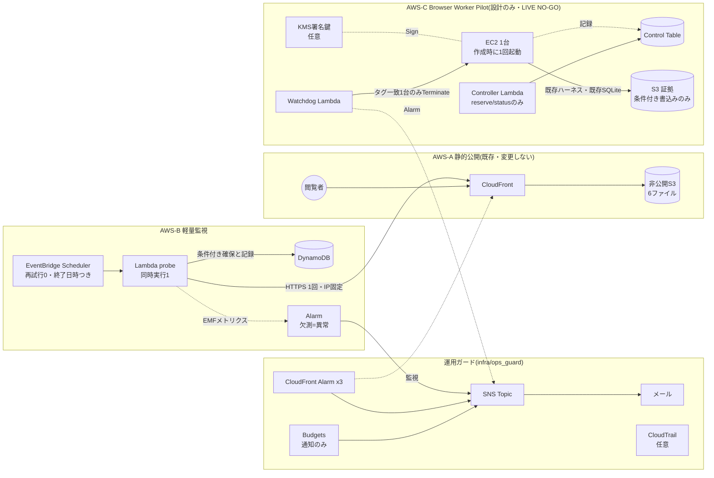
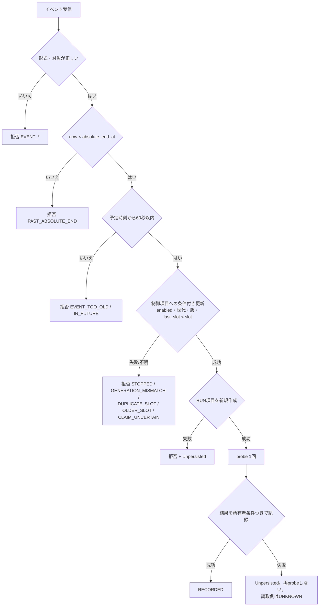
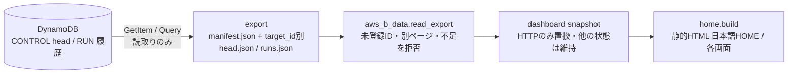
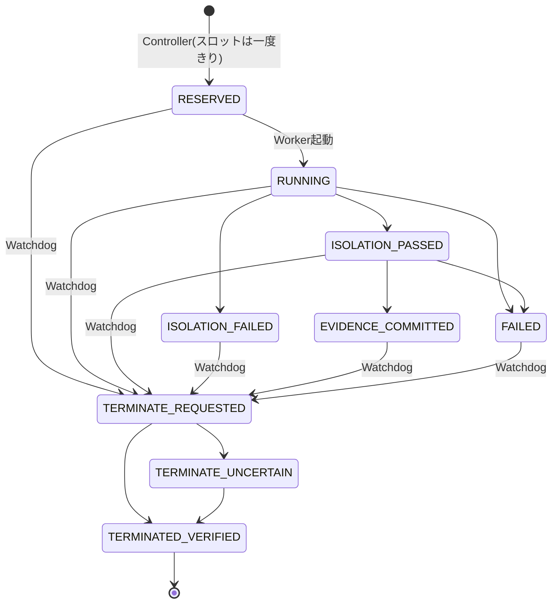

# SiteProof AWS構成(A / B / C と運用ガード)

状態(2026-11-13時点):

| 区分 | 状態 |
|---|---|
| AWS-A | 公開済み(2026-11-03のExecutor報告。今回再測定なし) |
| AWS-B | **2026-11-12に限定LIVE実証済み・撤収済み**(3サイト5ページ×2回、計10件HTTP 200)。現在は稼働しておらず、監視状態はUNKNOWN |
| 運用ガード | オフライン実装済み / LIVE未検証(AWS-Bの試験では試験用SNSトピックを使用し、撤収済み) |
| AWS-C | 設計・オフライン段階のみ。**LIVEはNO-GO**。実証済みとは扱わない。実装コード(`infra/aws_c` `src/aws_c` `tests/aws_c`)は今回の公開Commitに含まれない |

**読み方**: 実線は設計上の接続、点線は補助的な経路。図は設計を示し、実際に確認した動作は [EVIDENCE_INDEX.md](EVIDENCE_INDEX.md) の区分に従う。確認済みなのはAWS-Bの限定LIVEで述べる範囲のみ。以下の図の中で、AWS-Bのメトリクス→Alarm→SNSの自動通知経路は**設計・実装のみ**で、実障害からの発報は未実証(SNSは模擬ALARM／OKのメール受信のみ確認)。

## 全体

## 役割の分離

| 区分 | 何を証明するか | 何を証明しないか |
|---|---|---|
| 運用ガード | 通知経路、費用の可視化、操作記録 | 支出の上限、自動停止 |
| AWS-A | 非公開S3＋OACの静的配信、セキュリティヘッダ | 監視・撮影・サーバー側処理 |
| AWS-B | 冪等なサーバーレス実行、停止、通知、最小権限 | ネットワーク層の出口制御、ブラウザ表示品質 |
| AWS-C | 非信頼コード(ブラウザ)の隔離、証拠の完全性、多層停止 | 反復運用、実サイト品質、描画条件の真正性 |

AWS-BのPASSはAWS-CのPASSではなく、逆も同じ。LocalのPASSはAWSのPASSではない。

## AWS-B: 1イベントの判定順

拒否はすべて外向き接続の前に起きる。確保は1回の条件付き書込みなので、停止・重複・逆順の判定に読取りと書込みの隙間が無い。

## 製品統合: AWS-Bの保存結果から日本語HOMEまで

- 取込みは読取り専用。描画時に比較・Baseline承認など書込みを伴う処理は呼ばない。
- manifestに無いページは「未取得 UNKNOWN」。HTTP・比較・Baseline・証拠・総合品質は別の状態として扱い、HTTP 200を総合品質PASSにしない。
- 取込結果は出所未認証の入力であり、AWS実測の認証済み表示ではない。
- 実測確認: 2026-11-12の保存結果(10件)をこの経路で取り込み、ページごとに分離して表示するローカルプレビューを作成(公開サイトには未デプロイ)。ローカル専用のAWS OPERATIONS画面も公開サイトへはデプロイしない。
- 詳細: [AWS_B_TO_HOME.md](AWS_B_TO_HOME.md)

## AWS-C: 制御状態(設計・オフライン資産。LIVE未実施)

`RESERVED` や `RUNNING` へ戻る遷移は無い。制御記録は記録であり、Terminateの前提条件ではない。

## 既存資産との対応

| 既存(無変更) | AWSでの使い方 | 新規に足したもの |
|---|---|---|
| `src/core`(状態・結果の語彙、HTTP分類) | B: 結果は PASS/FAIL/UNKNOWN、3xxはUNKNOWN | `src/aws_b/model.py` |
| `src/isolation/destination.py` `connector.py` | B: 宛先allowlistとIP固定接続 | `src/aws_b/probe.py` |
| `src/storage`(SQLite、write-once、manifest、`plan_recovery`) | C: Worker内でそのまま使用。公開前の再検証に使用 | `src/aws_c/evidence.py` `s3_publisher.py` |
| `src/runtime/docker_launcher.py`、`tests/runtime/validate.py`、seccomp | C: Linuxホストで同じハーネスを実行 | `src/aws_c/linux_launcher.py`(CLIパスのみ差替え) |
| `infra/public_web`、`tests/aws_public` の契約テスト方式 | ガード/B/Cのテンプレート契約テスト | `tests/cfn_contract.py` ほか |
| M4/M5 のplan/receipt(メモリ内鍵のHMAC) | 変更しない。昇格しない | `src/aws_c/signer.py`(KMS署名の候補) |
